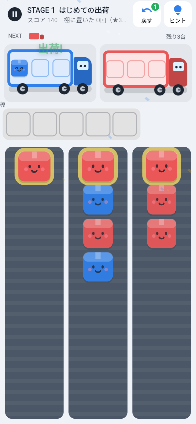

# SORT FACTORY（仮称）

レーンに積まれた荷物を、同じ色のトラックへ送り出して出荷する縦画面2Dパズル。出荷が連鎖する爽快感と、先を読んで解く手応えが核。
Flutter + Flame製、Android / iOS対応、オフラインで遊べる基本無料ゲーム（広告＋買い切り課金）。



> ステータス: **MVP実装済み（Phase 1〜3完了、Phase 4はテストID構成まで）**。実機テスト・ストア設定は未実施。

---

## 🎮 試遊（Web版）

- https://gangidenset.github.io/sort-factory-game/ （`?unlock=all` で全ステージ開放）
- テスター向け案内・質問票: [docs/PLAYTEST.md](docs/PLAYTEST.md)
- 初回のみ、リポジトリの Settings → Pages → Source を「GitHub Actions」にする必要があります。

## 1. 技術構成

| 項目 | 採用 | 備考 |
|---|---|---|
| アプリ | Flutter 3.47 (Dart 3.13) | Android / iOS、縦画面固定 |
| ゲームエンジン | Flame 1.38 | 描画とタッチ入力のみ。ルールは純Dartエンジンに分離 |
| UI | Material 3 | |
| ローカル保存 | shared_preferences（JSON・バージョン付き・バックアップ付き） | SQLiteは不要と判断（データ量が小さいため） |
| 効果音 | flame_audio + 自作合成WAV（`tool/gen_sfx.py`） | 外部素材ゼロ＝ライセンスリスクなし |
| 広告 | google_mobile_ads（AdMob + UMP同意） | ID はビルド時注入。未設定ならテストID / 無効 |
| 課金 | in_app_purchase（Play Billing / StoreKit） | 非消耗型（買い切り）のみ |
| 分析 | `Analytics` 抽象 + Debug実装 | Firebase等は後から差し替え |
| サーバー | なし | 初期版はオフライン完結 |

## 2. ディレクトリ構成

```
lib/
  main.dart                 起動・依存関係の組み立て
  app/                      MaterialApp、テーマ、サービスコンテナ
  game/
    logic/                  ★ゲームルール（純Dart・Flame非依存・テスト対象）
      game_session.dart       1プレイの状態機械（レーン/トラック/棚/連鎖/戻す/復活）
      models.dart             荷物・条件・ドック・操作の型
      solver.dart             ソルバー（ヒント・可解性テスト）
      stage_config.dart       ステージ定義（JSON→型、バリデーション）
      stage_repository.dart   ステージカタログ
      rng.dart                プラットフォーム非依存の乱数（再現性）
    flame/                  描画と入力（レイアウト計算、荷物描画、タップ/ドラッグ）
  data/                     セーブデータ、保存/復旧/移行、進行管理(ProgressController)
  economy/                  設備強化・コスメ・ミッション定義、報酬式
  services/
    ads/                    AdMob実装・頻度ポリシー・AdManager
    iap/                    商品定義・購入/復元
    analytics/              分析抽象
    audio/                  効果音・振動
  screens/                  タイトル/ステージ選択/ゲーム/工場/ショップ/設定
  ui/                       配色・共通ウィジェット・文言(strings.dart)
assets/
  stages/stages.json        30ステージ（コードから分離）
  audio/*.wav               自作効果音
tool/
  gen_stages.py             ステージ生成（ソルバーで可解性・par計算、難易度調整）
  gen_sfx.py                効果音合成
test/                       ロジック・保存・広告/課金・レイアウト・ウィジェットテスト
docs/                       設計書・収益化・KPI・リリース手順・ロードマップ
web/                        ブラウザ試遊用ビルド（社内テスト用途のみ）
```

## 3. ゲームシステム（概要）

- **レーンをタップ** → 先頭の荷物が同じ色のトラックへ自動で飛ぶ。合うトラックがいなければ **棚** へ。
- トラックは満載で出荷し、`NEXT` の次のトラックが到着。到着したトラックは棚から同色を自動で積み、満載ならまた出荷 → **連鎖**。
- 棚があふれたら失敗。**時間制限なし**、自分のペースで先を読むパズル。
- ★3 = 棚に置いた回数がソルバーの最小値（par）以内。全30ステージ可解をテストで保証。
- ギミック：見えない荷物（?）、鍵付きレーン、大型トラック。救済：戻す／ヒント／復活（広告）。
- 詳細・v1からの方針転換の理由は [docs/DESIGN.md](docs/DESIGN.md)。

## 4. 収益化（概要）

- **リワード広告（任意）**: 失敗時の復活／クリア後コイン2倍／ヒント（20秒間正解先を表示）。
- **インタースティシャル**: クリア後の区切りのみ。最初の5ステージは無し、4クリアごと、最短180秒間隔、設定で4/6/8回に変更可。プレイ中は絶対に出さない。
- **バナー**: 使わない。
- **課金**: 広告削除(600円)を最優先。初心者応援パック/工場スキン/プレミアムパックも実装済み（ストア登録待ち）。
- 詳細は [docs/MONETIZATION.md](docs/MONETIZATION.md)。

## 5. 開発ロードマップ

[docs/ROADMAP.md](docs/ROADMAP.md) を参照。

## 6. 開発環境・コマンド

```bash
flutter pub get
flutter analyze
flutter test                          # 全テスト（約110件）
flutter run                           # デバッグ実行（テスト広告ID）
python3 tool/gen_stages.py            # ステージ生成（可解性・par・難易度レポート）
python3 tool/gen_sfx.py               # 効果音再生成
flutter build web --no-web-resources-cdn   # ブラウザ試遊ビルド
```

本番ビルド（広告ID・署名の注入）は [docs/RELEASE.md](docs/RELEASE.md)。

## 7. 前提・仮定（ユーザー確認なしで決めたこと）

| # | 判断 | 理由 |
|---|---|---|
| A1 | パッケージ名 `com.sortfactory.sort_factory`（仮） | 公開前に正式なドメイン／ブランドへ変更推奨 |
| A2 | 保存は shared_preferences + JSON | データが小さく、SQLiteより実装・保守コストが低い |
| A3 | 効果音は自作合成、画像は全てコード描画 | ライセンス不明素材ゼロ・アプリ容量最小 |
| A4 | 文言は日本語、`ui/strings.dart` に集約 | 海外展開時にARB化しやすくするため |
| A5 | 購入検証は端末内のみ（MVP） | サーバー無し方針。規模拡大前にサーバー検証を追加（RELEASE.md） |
| A6 | インタースティシャル猶予を「最初の5ステージ」 | 指示書の「最初の数ステージ」を具体化 |
| A7 | 復活はリワード広告で1プレイ1回まで | 広告視聴の価値を保ちつつ難易度の形骸化を防ぐ |
| A8 | 設備強化は「アシスト」に限定（戻す+、棚+、コイン+） | 課金や強化無しでも全ステージクリア可能であることを自動テストで保証 |
| A9 | ブラウザ版(web/)は社内試遊用で公開しない | 広告・課金はモバイルのみ |

## 8. 作業ログ

| 日付 | 内容 |
|---|---|
| 2026-11-08 | 空リポジトリを確認し Flutter 3.47.9 / Flame 1.38 でプロジェクト新規作成 |
| 2026-11-08 | 純Dartのゲームエンジン（判定・スコア・ギミック・復活・ヒント）とテストを実装 |
| 2026-11-08 | 30ステージをJSON化。疑似プレイヤー（熟練/平均/カジュアル）でバランス調整：プレイ時間が短すぎた（〜15秒）ため空ベルト時の出現加速を3倍→1.5倍、配送目標を約25%増、★閾値を引き上げ。結果は docs/balance_report.txt |
| 2026-11-08 | セーブ（バックアップ・破損復旧・移行）、経済（強化/コスメ/レベル/デイリーミッション）を実装 |
| 2026-11-08 | AdMob（UMP同意・リワード・インタースティシャル頻度制御）、IAP（購入・復元・冪等な付与）を実装 |
| 2026-11-08 | Flame描画（タップ/ドラッグ、ヒント、演出）と全8画面を実装。小画面でのタッチ領域不足・タイトル画面のはみ出し・ビルド中の通知などテストで検出し修正 |
| 2026-11-08 | Webビルドでブラウザ上の実プレイを確認（ドラッグ仕分け・ミス演出・ヒント表示） |
| 2026-11-11 | **試遊で「面白くない・爽快感がない」→ ターン制の出荷パズルに作り直し**。ソルバー付きステージ生成、連鎖演出、顔つきの荷物・トラック、戻す/ヒント/復活、セーブv2移行（旧ステージ記録破棄・旧強化コイン返金） |
| 2026-11-09 | GitHub Pages への試遊版自動公開（CIでanalyze/test実行）、PC表示時のスマホ枠、`?unlock=all`、試遊ガイドを追加 |
